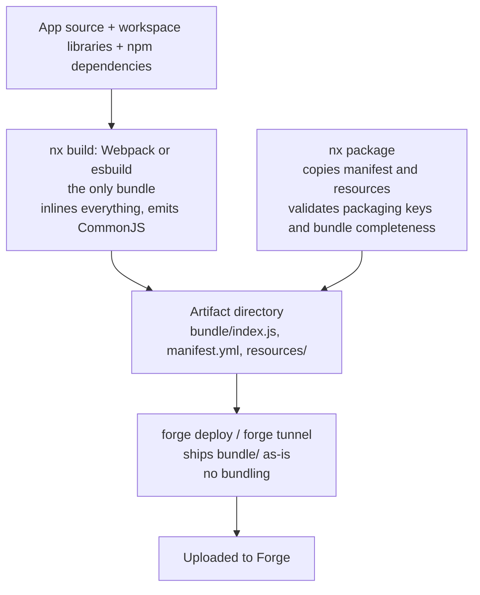
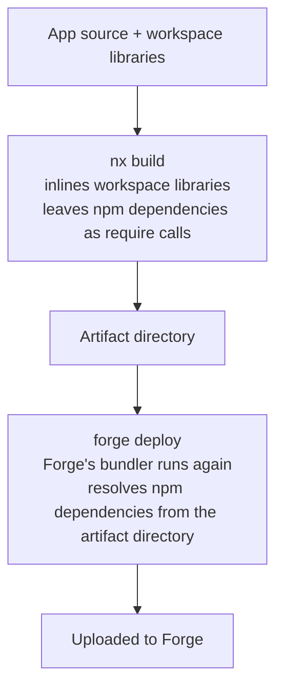

# Plugin concepts

This page explains how Nx Forge turns a Forge app project into something the Forge platform can run, and why it works the way it does.

## From source to deployment

A Forge app project generated by [the app generator](../guides/generating-a-forge-app.md) has a `build` target from a standard Nx bundler plugin and a set of Forge targets inferred by Nx Forge. Three of them form the path to the Forge platform:

::: tip Targets to deploy a Forge app

build -> package -> deploy

:::

Each target writes to or reads from the same folder in `dist`, the _artifact directory_. For a project in `apps/my-app`, that is `dist/apps/my-app`.



Because these targets almost always run in this order, it is worth [defining target defaults for them](../guides/getting-started.md#configuring-target-defaults). If you also enable caching for `build` and `package`, Nx reuses their results, so running them before every `deploy` costs little. Do not cache `deploy`: a cache hit would skip the deployment.

## The build target

The `build` target compiles the app's TypeScript and bundles it. Any Nx plugin that can bundle a Node application can provide it. The app generator sets up `@nx/webpack` by default, or `@nx/esbuild` if you ask for it.

Nx Forge does not care which bundler you use. It only relies on what the bundler writes to `<artifact>/bundle`:

- `index.js` is a CommonJS module that exports the handlers the manifest refers to. A handler `index.handler` in the manifest means the `handler` export of `bundle/index.js`.
- Everything is inlined except Node built-ins. That includes your workspace libraries and your npm dependencies.
- A source map, `index.js.map`, may sit next to it.

This is the _build contract_. If your build meets it, the rest of the pipeline works, whatever bundler or configuration produced it.

## The package target

The `package` target turns the build output into a complete Forge app. It:

- copies `manifest.yml` from the project into the artifact directory,
- copies the build output of each Custom UI and UI Kit project the manifest refers to into `<artifact>/resources`, and points the copied manifest at them (see [the project graph](project-graph.md)),
- checks that the manifest asks Forge to ship the bundle unchanged (see below),
- checks that the bundle is complete: no `.js` or `.cjs` file in it loads a module by a literal name that is neither a Node built-in nor a file inside the bundle. Modules loaded by a computed name, such as `require(name)`, are not checked.

If a check fails, `package` stops and tells you what to fix. The result is the [artifact directory layout](workspace-layout.md#build-output) that `deploy` and `tunnel` work from.

## Shipping the bundle unchanged

By default, the Forge CLI bundles an app itself when you deploy it. Nx Forge switches that off with Forge's [manual packaging](https://developer.atlassian.com/platform/forge/manifest-reference/packaging/). These keys in the project's `manifest.yml` tell the Forge CLI to upload the `bundle` folder as it is:

```yaml
app:
  package:
    bundler: manual@2026
    path: bundle
```

`path` is relative to the artifact directory, where the Forge CLI runs, not to the project.

The keys live in the source manifest, so what you read in your project is what Forge gets. The app generator writes them, and `package` checks them rather than adding them behind your back.

## Why Nx Forge bundles and Forge does not

Forge's own bundler is designed for a single Forge app with its own `package.json` and `node_modules`. In an Nx workspace, that is not where your code lives. An alternative would be to let Nx compile the code and leave the npm dependencies for Forge's bundler to pull in at deploy time:



That design bundles twice, and the second bundler resolves dependencies from the artifact directory in `dist`, not from the project the code was written in. It works only when every dependency happens to be findable from there. With pnpm, or any workspace that does not hoist all dependencies into one root `node_modules`, it finds the wrong version or nothing at all. It also needs a generated `package.json` in the artifact directory and forces the build output into a folder Forge's bundler expects. And it gains nothing: Forge's bundler inlines everything anyway.

Bundling once, in Nx, avoids all of that. The bundler runs where the code lives, so it resolves the same dependencies your editor, tests and type checker see. What you build is exactly what Forge runs.

The trade-off is that nothing at deploy time fills a gap in the bundle. If the build leaves a module out, Forge would only notice when a function first loads it. That is why `package` checks the bundle for completeness before you deploy. Some packages contain optional `require` calls for modules they can do without; the [`allowMissingModules`](../reference/executors.md#package) option of `package` names those.

## Consequences for Forge lint and tunnel

`forge deploy` runs Forge lint first, unless you pass `--no-verify`. Forge lint parses only JavaScript under `./src`, and the bundle lives in `bundle`. Lint therefore still checks the manifest and that the handler files exist, but it does not inspect your function code. Use your workspace's own lint and type checks for that.

The [`tunnel`](../reference/executors.md#tunnel) executor runs the build in watch mode, packages the app once, and starts `forge tunnel` in the artifact directory. `forge tunnel` picks up each rebuild without a restart. Inside a workspace, `forge tunnel` can resolve a module that is missing from the bundle from the workspace's `node_modules`. A function can then work in the tunnel and fail after deployment. The completeness check in `package` catches this for modules that the bundle loads by a literal name, so keep it in your deploy path.

## Plugin targets

Nx Forge provides [a set of executors](../reference/executors.md) for developing, building and deploying Forge apps in an Nx workspace. Prefer its [`register`](../reference/executors.md#register) and [`deploy`](../reference/executors.md#deploy) executors over the matching Forge CLI commands. They integrate with the workspace, for example by writing the registered app ID back to the project's manifest.

Where Nx Forge has no dedicated executor, use the [`forge`](../reference/executors.md#forge) executor to call the Forge CLI. It runs the command in the app's artifact directory.
