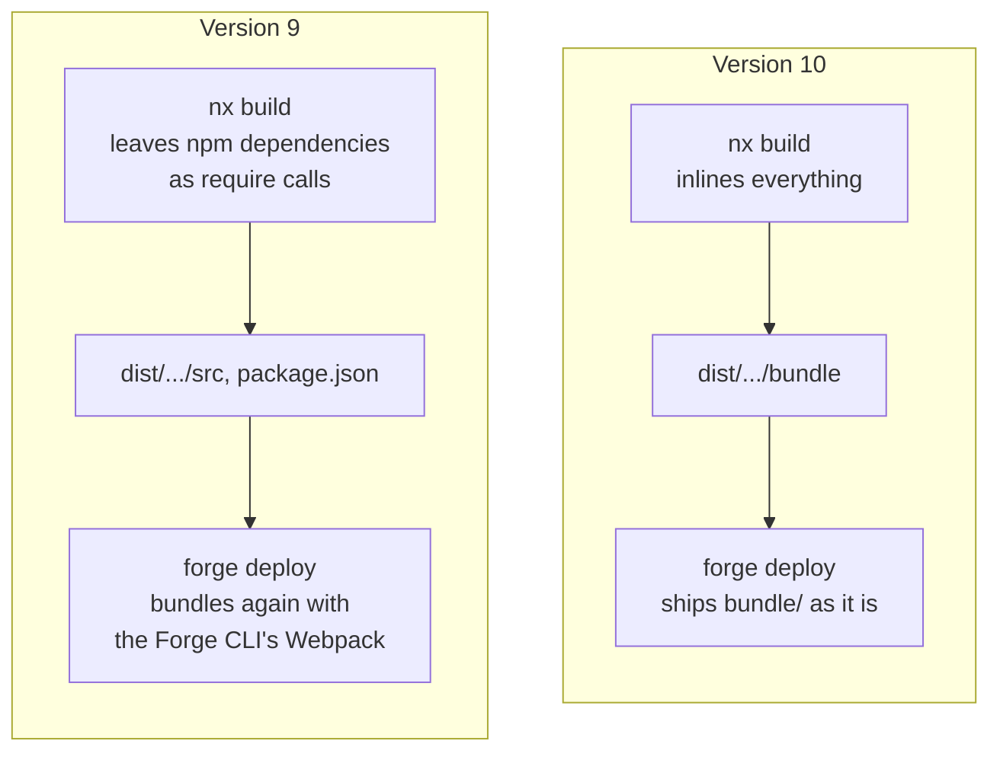

# Upgrading to v10

This guide shows you how to upgrade a workspace from Nx Forge 9 to Nx Forge 10.

## What changed

In version 9, a Forge app was bundled twice. The Nx `build` target bundled the app code but left npm dependencies as `require()` calls in `<artifact>/src`. Then `forge deploy` bundled it again with Forge's Webpack, resolving the dependencies from the artifact directory in `dist`. This broke with pnpm and other layouts where dependencies are not all hoisted to one `node_modules`, and it needed a generated `package.json`.

In version 10, the Nx `build` target is the only bundler. It inlines everything, including npm dependencies, into `<artifact>/bundle/index.js`. The Forge CLI then ships that bundle as it is, through Forge's [manual packaging](https://developer.atlassian.com/platform/forge/manifest-reference/packaging/).



For the reasoning behind this design, see [Plugin concepts](../concepts/plugin-concepts.md).

In practice, this means:

- The build writes to `<artifact>/bundle` instead of `<artifact>/src`, and must inline npm dependencies.
- `manifest.yml` needs the `app.package` keys for manual packaging.
- The `package` executor no longer generates a `package.json`. Its `tsConfig` option is removed. It checks the packaging keys and that the bundle is complete.
- You need Forge CLI 15.1.0 or later.

## Before you start

This guide assumes your workspace uses Nx Forge 9 and Nx 24. If it uses an older version, first upgrade to the latest 9.x release, following the [release notes](https://github.com/toolsplus/nx-forge/releases) of each major version.

Nx Forge 10 supports classic Nx workspaces, where projects are linked through TypeScript path aliases.

Commit or stash your changes, so you can review what the migration changes.

## 1. Update the Forge CLI

Install Forge CLI 15.1.0 or later and check the version:

```shell
npm install -g @forge/cli@latest
forge --version
```

Nx Forge runs the Forge CLI installed in your workspace, and the global one only if the workspace has none. If your workspace has `@forge/cli` as a dependency, update it there as well and check the version with `npx forge --version` (or your package manager's equivalent).

Older versions do not support manual packaging.

## 2. Run the migration

Update the plugin and run its migrations:

```shell
nx migrate @toolsplus/nx-forge@latest
nx migrate --run-migrations
```

For each Forge app project, the migration:

- if the build configuration has the shape of a generated app, changes the build output path from `.../src` to `.../bundle` and makes the build inline npm dependencies:
  - Webpack: in the `NxAppWebpackPlugin` options in `webpack.config.js`, it changes `outputPath` and adds `externalDependencies: 'none'`,
  - esbuild: in the `@nx/esbuild:esbuild` build target in `project.json`, it changes `outputPath` and sets `thirdParty: true`,
- adds the `app.package` keys to `manifest.yml` if it has no `package` section yet, keeping your comments and formatting,
- removes the `tsConfig` option from `package` targets.

When it finishes, the migration prints next steps for everything it could not change. Keep that output for the next steps. If you work with an AI agent, run `nx migrate --run-migrations --agentic` instead: Nx gives the agent instructions for the changes that the migration could not make.

## 3. Review the build configuration

Compare each app's build configuration with what a new app gets. Make the changes the migration listed, and the ones below that it does not make.

### Webpack

A new app's `webpack.config.js` looks like this:

```js
const { DefinePlugin, IgnorePlugin } = require('webpack');
const { NxAppWebpackPlugin } = require('@nx/webpack/app-plugin');

module.exports = {
  output: {
    // Forge loads function handlers from the exports of index.js, so the
    // bundle must assign the entry module's exports to `module.exports`.
    library: { type: 'commonjs2' },
    filename: 'index.js',
  },
  plugins: [
    new NxAppWebpackPlugin({
      target: 'node',
      compiler: 'tsc',
      outputPath: '../../dist/apps/my-app/bundle',
      main: './src/index.ts',
      outputFileName: 'index.js',
      tsConfig: './tsconfig.app.json',
      assets: ['./src/assets'],
      externalDependencies: 'none',
      sourceMap: true,
      optimization: false,
      outputHashing: 'none',
      deleteOutputPath: false,
    }),
    new DefinePlugin({ 'process.env.NODE_ENV': JSON.stringify('production') }),
    new IgnorePlugin({
      resourceRegExp: /^encoding$/,
      contextRegExp: /node-fetch/,
    }),
    new IgnorePlugin({
      resourceRegExp: /^(bufferutil|utf-8-validate)$/,
      contextRegExp: /ws\/lib$/,
    }),
    new IgnorePlugin({
      resourceRegExp: /^dtrace-provider$/,
      contextRegExp: /bunyan$/,
    }),
  ],
};
```

The migration does not add these parts. Add them by hand:

- **`DefinePlugin` for `NODE_ENV`.** The Forge runtime does not set `NODE_ENV`, and the Forge CLI's bundler used to inline `production`. Without it, libraries that check `NODE_ENV` run their development code.
- **`sourceMap: true`.** It writes `index.js.map` next to the bundle.
- **The three `IgnorePlugin` rules.** They skip optional dependencies of `node-fetch`, `ws` and `bunyan`, as the Forge CLI's bundler did.

Check that `output.library` is set to `{ type: 'commonjs2' }`. Without it, the bundle does not export the handlers.

### esbuild

A new app's `build` target includes these options:

```json
{
  "executor": "@nx/esbuild:esbuild",
  "options": {
    "platform": "node",
    "outputPath": "dist/apps/my-app/bundle",
    "format": ["cjs"],
    "bundle": true,
    "thirdParty": true,
    "main": "apps/my-app/src/index.ts",
    "outputFileName": "index.js",
    "tsConfig": "apps/my-app/tsconfig.app.json",
    "assets": ["apps/my-app/src/assets"],
    "esbuildOptions": {
      "sourcemap": true,
      "outExtension": { ".js": ".js" },
      "define": { "process.env.NODE_ENV": "\"production\"" }
    }
  }
}
```

The migration does not change `esbuildOptions`. Add `define` and `sourcemap: true` by hand. If a configuration sets its own `esbuildOptions`, it replaces the ones in `options`. Apps generated with version 9 have such a `production` configuration, which also turns source maps off. Remove its `esbuildOptions`, or add `define` and `sourcemap: true` to it.

### Workarounds for the Forge CLI's bundler

If you added settings so that the Forge CLI's bundler could find your dependencies, remove them. The build must now inline every npm dependency, so remove any `externals` or `externalDependencies` lists that leave packages out of the bundle.

If the migration reported that it could not update a build configuration, make the changes above by hand.

## 4. Check the manifest keys

Open each app's `manifest.yml` and check that it contains:

```yaml
app:
  package:
    bundler: manual@2026
    path: bundle
```

`path` is relative to the artifact directory, not to the project. If the keys are missing or different, `package` fails and prints the lines to add.

## 5. Update custom paths

The bundle now lives in `<artifact>/bundle` instead of `<artifact>/src`. Search your workspace for the old path, for example `dist/apps/my-app/src`, and update anything you wrote by hand, such as:

- source map upload globs for error monitoring tools,
- scripts and CI steps that read or copy the build output,
- options passed on the command line, such as `--tsConfig` for `package`, which no longer exists.

## 6. Verify

Delete each app's artifact directory first, for example `dist/apps/my-app`. The build and `package` do not remove the old `src/` folder and `package.json`.

Then build, package and deploy each app:

```shell
nx run my-app:build
nx run my-app:package
nx run my-app:deploy
```

Check the result:

- `dist/apps/my-app` contains `bundle/` and `manifest.yml`, and no `package.json`. If the app has Custom UI or UI Kit resources, it also contains their build output in `resources/`, or in the folder that the `package` target's `resourcePath` option names.
- `package` passes. If it reports modules missing from the bundle, see [Bundle completeness](../reference/executors.md#bundle-completeness).
- After the deploy, call a function of the app, for example by opening a module that uses a resolver. The upload contains exactly the bundle you built, so this is the real test.

## What to know afterwards

- **Forge lint.** `forge deploy` still runs Forge lint unless you pass `--no-verify`. Forge lint parses only JavaScript under `./src`, so it no longer inspects your function code. It still checks the manifest and that the handler files exist. Rely on your workspace's own lint and type checks for the code.
- **Tunnel.** The `tunnel` executor waits for `bundle/index.js`, packages the app once and starts `forge tunnel`. `forge tunnel` picks up rebuilds without a restart. Inside the workspace, it can load a module that is missing from the bundle from `node_modules`, so a function can work in the tunnel and fail after deployment. `package` catches this before you deploy, for modules that the bundle loads by a literal name.
- **No `package.json`.** The artifact directory has no `package.json`. The bundle contains every dependency, and the Forge CLI does not need one.
- **Optional modules.** If `package` reports a missing module that a package loads only when it is present, and your code works without it, add it to the `allowMissingModules` option of the [`package` executor](../reference/executors.md#package).
